## Ubuntu Dock Folders

Group applications into folders on Ubuntu Dock, KDE Plasma and Xfce. Drag icons together to create a folder, reorder its applications, or drag them back to the panel.

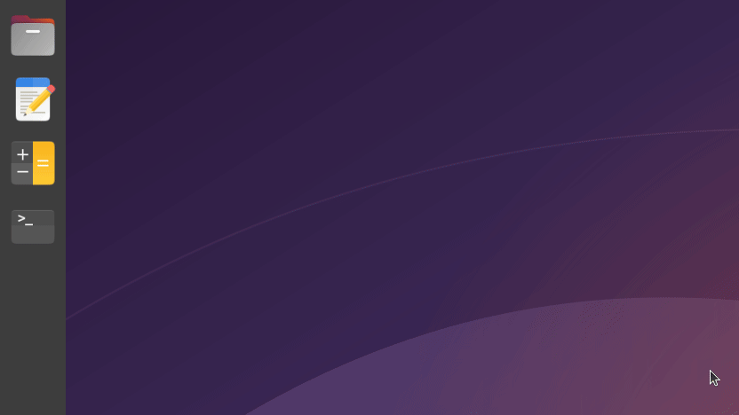

[Video](docs/demo.mp4) · [WebM](docs/demo.webm)

Customize each folder's colors, transparency, background blur, wallpaper and icon layout. Choose an opening animation, rotate icons around their orbit, or fan out cards on hover. Application artwork stays upright. Rotation speeds range from −999 to +999°/s; hover animation speed ranges from −999 to +999%. Settings apply immediately.

Reuse saved folders, synchronize GNOME app-grid folders, preview application windows on hover, and undo grouping changes. Folder appearance can be copied to all folders. The interface follows the system language and includes 30 translations.

| Feature | Ubuntu Dock Folders | Pin App Folders to Dash | Dash to Dock |
| --- | --- | --- | --- |
| Create folders by dropping panel icons together | Yes | Uses app-grid folders | — |
| One running indicator for a folder | Yes | — | Per application |
| Per-folder colors, wallpaper, transparency and blur | Yes | — | Dock-wide appearance |
| Folder opening animations and orbital icon rotation | Yes | — | — |
| Reuse GNOME app-grid folders | Yes | Yes | — |
| Window previews with activation and close controls | Yes | — | Yes |
| Undo folder creation and moves | Yes | Pin/unpin | — |
| Desktop adapters | GNOME, KDE Plasma, Xfce | GNOME | GNOME |

Sources: [Pin App Folders to Dash](https://extensions.gnome.org/extension/5709/pin-app-folders-to-dash/), [Dash to Dock](https://github.com/micheleg/dash-to-dock).

<details>
<summary>GNOME settings</summary>

**Ubuntu Settings → Ubuntu Desktop → Dock**

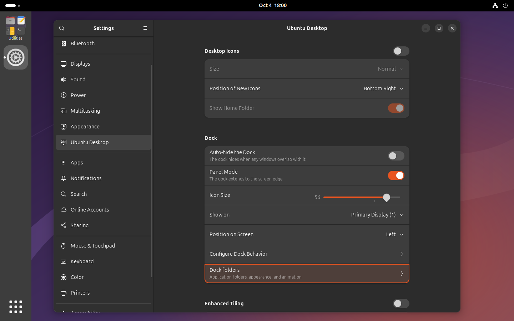

**General settings — On the dock**

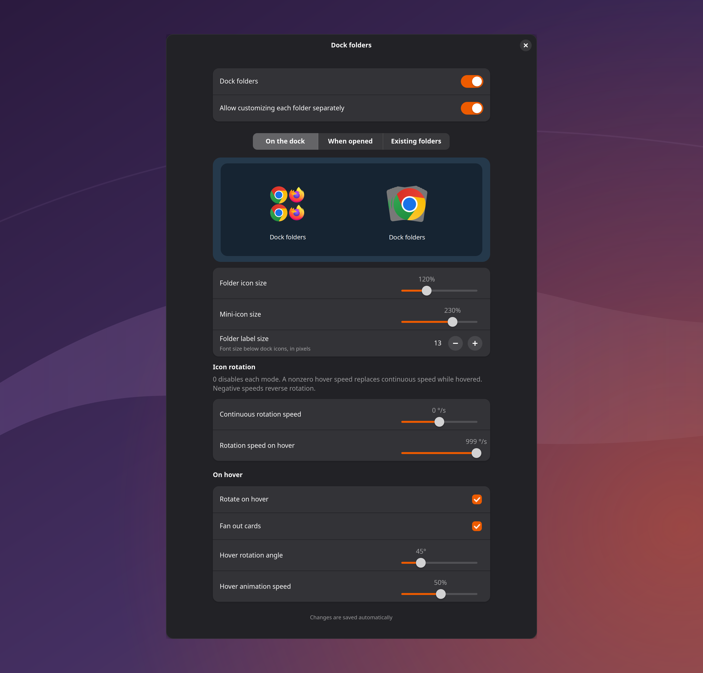

**General settings — When opened**

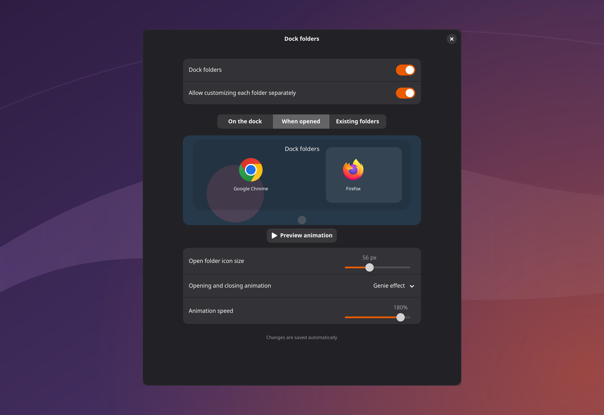

**General settings — Existing folders**


**Folder settings — On the dock**

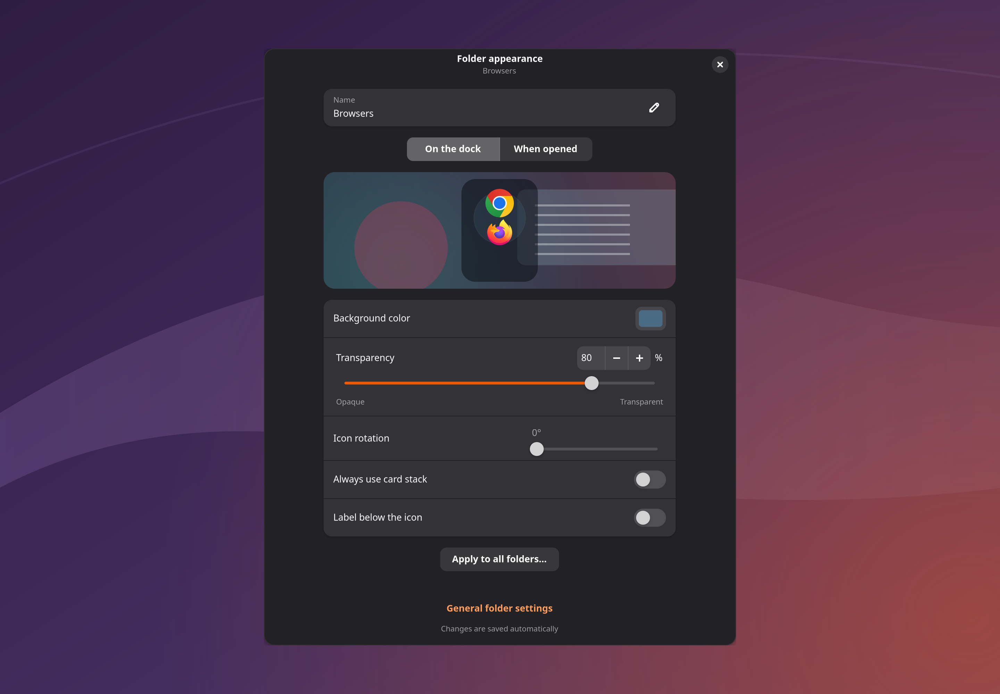

**Folder settings — When opened**


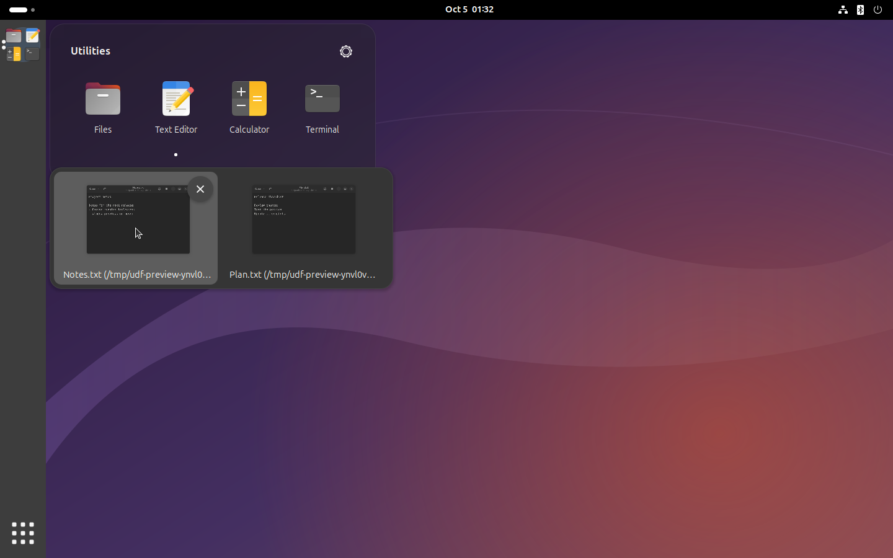

</details>

<details>
<summary>KDE Plasma settings</summary>

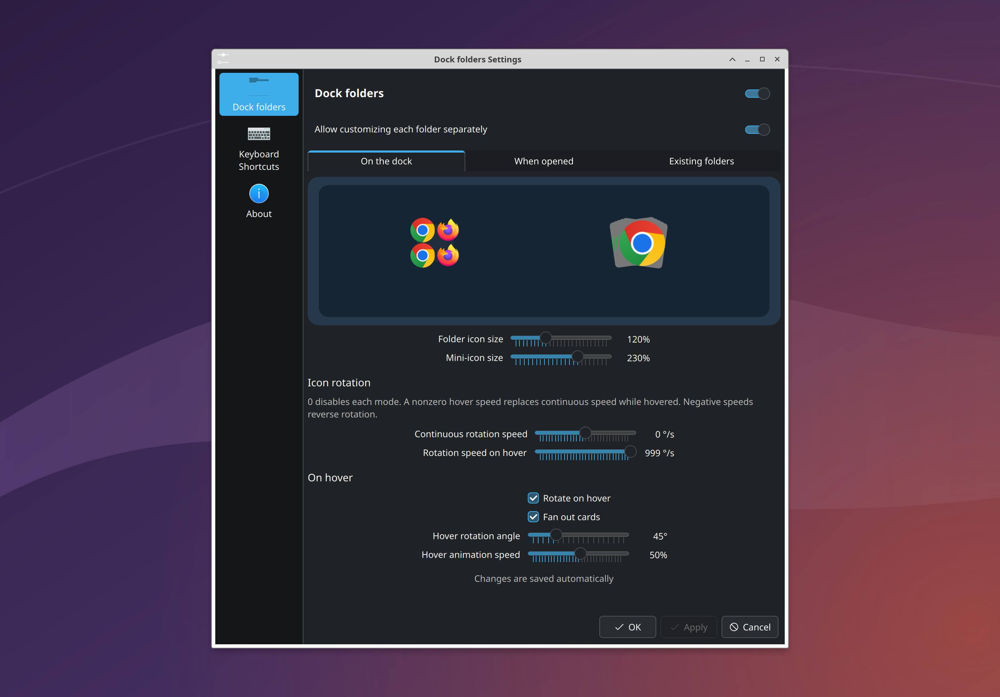

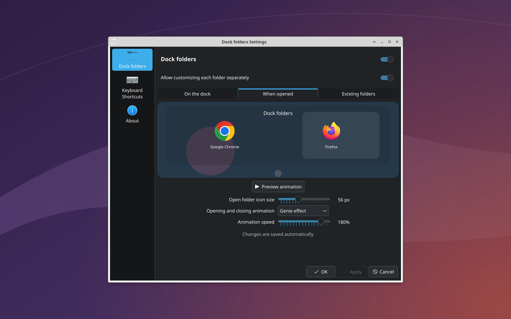

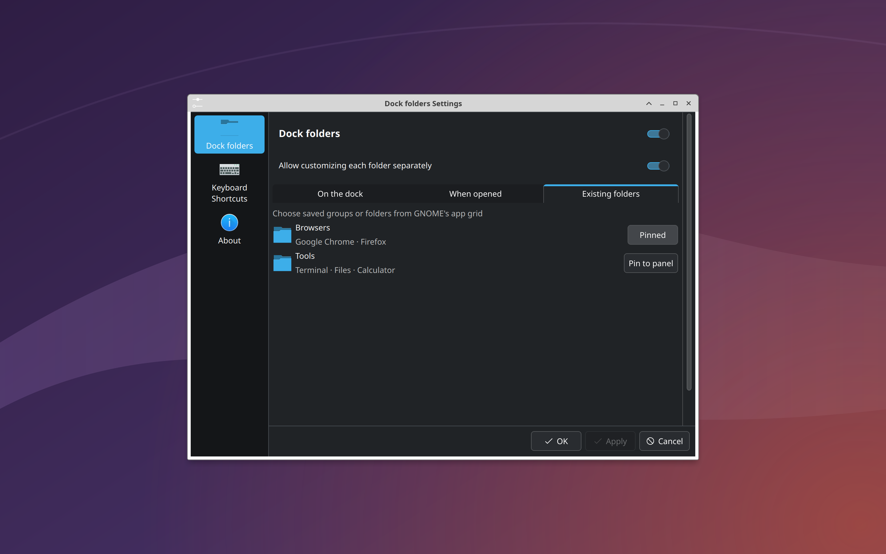

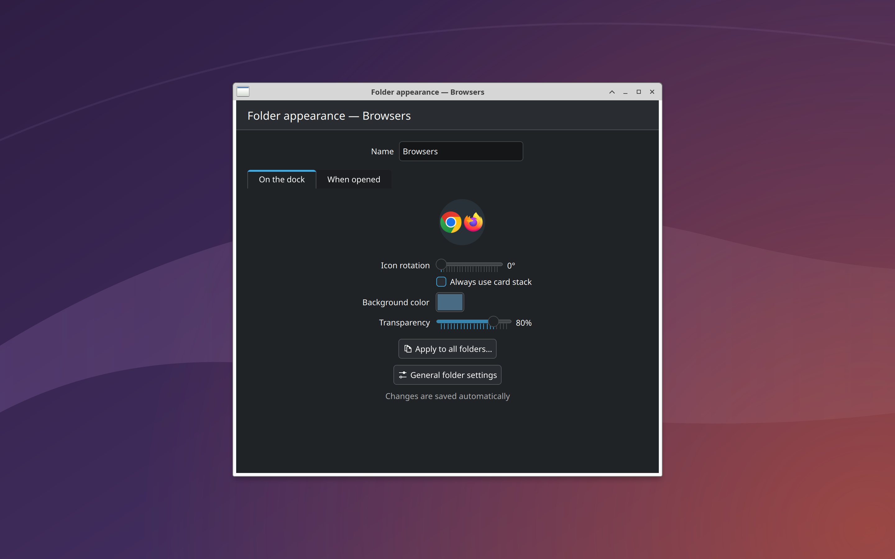

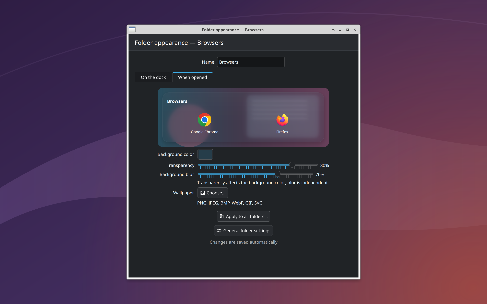

</details>

<details>
<summary>Xfce demo and settings</summary>

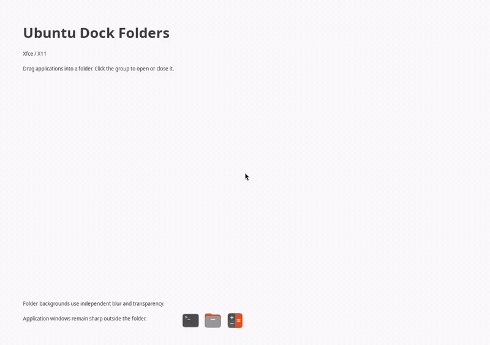

[Video](docs/xfce/demo.mp4) · [WebM](docs/xfce/demo.webm)

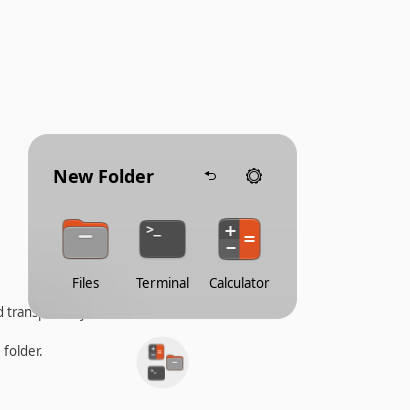


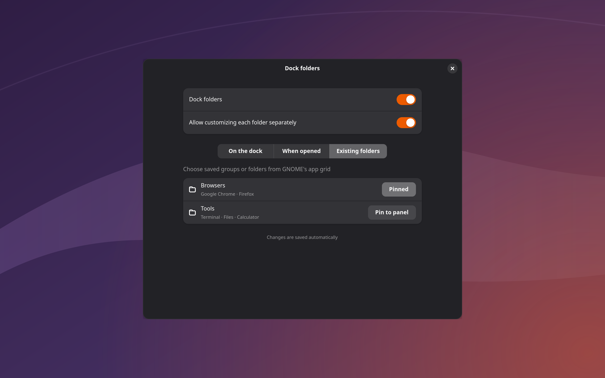


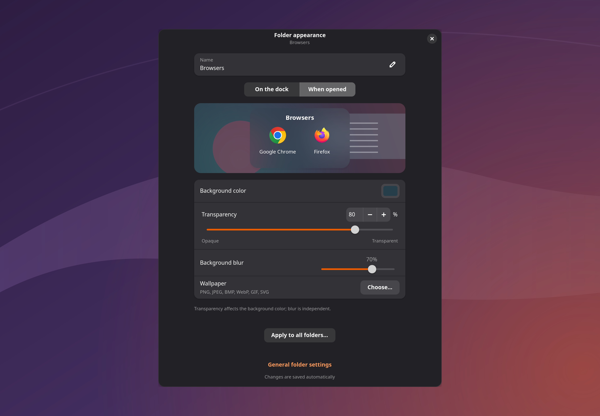

</details>

[](https://hawkab.github.io/support/)

<details>
<summary>TON wallet</summary>


```text
UQAHqYcL2i1sls0c_R9o22r-m3zORIg2bzCC1gGW4rjK94G9
```

</details>

## Install and configure

| Package | Desktop versions | Sessions |
| --- | --- | --- |
| 1.2.2 for Ubuntu 24.04 | GNOME 46 with Ubuntu Dock | Wayland, X11 |
| 1.2.2 for Ubuntu 26.04 | GNOME 50 with Ubuntu Dock, KDE Plasma 6.6+, Xfce 4.20+ | Wayland; X11 on KDE and Xfce |

Install from the [signed APT repository](https://hawkab.github.io/apt/):

```sh
sudo install -d -m 0755 /etc/apt/keyrings
curl -fsSL https://hawkab.github.io/apt/archive-key.gpg | sudo tee /etc/apt/keyrings/hawkab-archive-keyring.gpg >/dev/null
. /etc/os-release
curl -fsSL "https://hawkab.github.io/apt/${VERSION_CODENAME}.sources" | sudo tee /etc/apt/sources.list.d/hawkab.sources >/dev/null
sudo apt update
sudo apt install ubuntu-dock-folders
ubuntu-dock-folders enable --ubuntu-settings
```

Or use the [Launchpad PPA](https://launchpad.net/~hwakaba/+archive/ubuntu/ubuntu-dock-folders):

```sh
sudo add-apt-repository ppa:hwakaba/ubuntu-dock-folders
sudo apt update
sudo apt install ubuntu-dock-folders
ubuntu-dock-folders enable --ubuntu-settings
```

For manual installation, download the `.deb` from [GitHub Releases](https://github.com/hawkab/ubuntu-dock-folders/releases), open it in the package installer, or run `sudo apt install ./ubuntu-dock-folders_*.deb`.

Build from source:

```sh
git clone https://github.com/hawkab/ubuntu-dock-folders.git
cd ubuntu-dock-folders
sudo apt install python3-debian
python3 scripts/debian_target.py configure
sudo apt-get build-dep .
dpkg-buildpackage -b -us -uc
sudo apt install ../ubuntu-dock-folders_*_amd64.deb
ubuntu-dock-folders enable --ubuntu-settings
```

`make install` installs the GNOME extension. Restart the GNOME session after updating it. The combined package selects the desktop adapter at login.

Open **Ubuntu Dock Folders** from the application menu. In GNOME, use **Settings → Ubuntu Desktop → Dock → Dock folders**. In KDE, use **Configure** on the widget; in Xfce, use the plugin's **Configure** menu.

Use **On the dock**, **When opened** and **Existing folders** to configure the panel. Open a folder's gear for its appearance settings. **Apply to all folders** copies its appearance; **Undo** reverses a grouping move.

Wallpaper formats: PNG, JPEG, BMP, WebP, GIF and SVG. Folder settings are retained after removal.

```sh
ubuntu-dock-folders uninstall
sudo apt remove ubuntu-dock-folders
```

Copyright © 2026 Grigory Olshansky. [GPL-3.0-or-later](LICENSE).
